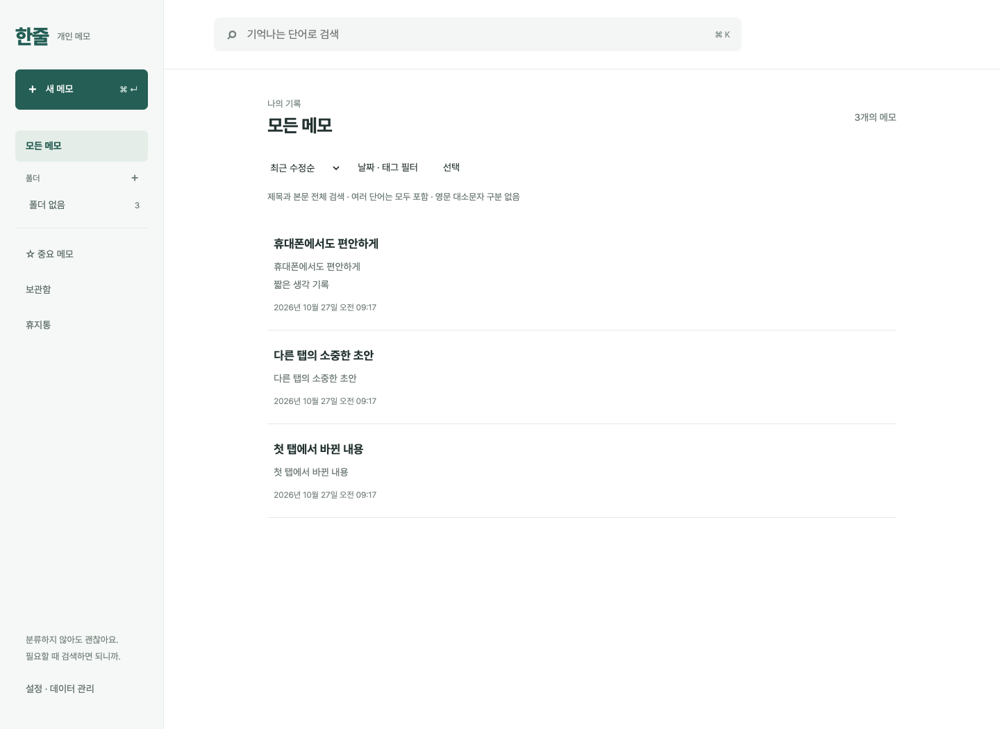
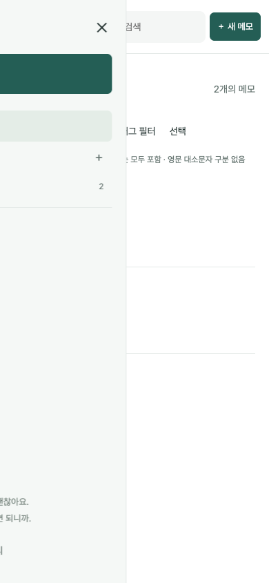

# 한줄 · HanJul

**분류보다 기록을 먼저. 기억나는 단어로 다시 찾는 개인 메모 웹앱.**

떠오른 생각, 업무 중 기억할 내용, 링크와 스크린샷을 제목 없이 바로 적습니다. 메모와 첨부파일은 내가 선택한 NAS·AWS·로컬 서버에 보관하고, 컴퓨터와 휴대폰에서 같은 서버에 접속해 사용합니다.

[만든 목적과 장점](docs/WHY-HANJUL.md) · [설치 경로](docs/SELF-HOSTING.md) · [전체 기능](docs/FEATURES.md) · [백업·복구](docs/BACKUP.md)



## 왜 한줄인가요?

- **먼저 쓰고 나중에 정리합니다.** 제목과 폴더는 선택 사항입니다. 첫 의미 있는 줄이 목록 제목이 됩니다.
- **기억나는 단어로 찾습니다.** 한국어 부분 문자열 검색, 여러 단어 검색, 태그·폴더·날짜 필터를 제공합니다.
- **기록 흐름을 이어갑니다.** 자동 저장, 명시적인 저장 상태, 로컬 초안 복구, 기기 간 수정 확인을 제공합니다.
- **자료를 함께 보관합니다.** 이미지 붙여넣기, 첨부, 체크리스트, 간단한 글자 서식과 표를 지원합니다.
- **저장 위치를 직접 선택합니다.** SQLite에 메모와 첨부를 함께 저장하고 Markdown·첨부 ZIP으로 내보낼 수 있습니다.

## 내 컴퓨터에서 시작하기

Docker Engine + Compose v2 또는 Docker Desktop을 설치한 뒤 실행하세요.

```sh
git clone https://github.com/stranger828/hanjul-selfhosted.git
cd hanjul-selfhosted
docker compose up -d --build --wait
docker compose exec memo cat /data/initial-password.txt
```

[http://localhost:8787](http://localhost:8787)에 접속해 출력된 최초 비밀번호로 로그인하고 **설정 → 비밀번호 변경**에서 바꿉니다. 변경 뒤 최초 비밀번호 파일은 삭제됩니다. 메모 데이터는 Docker 영속 볼륨에 남습니다. 앱을 닫거나 `docker compose down`을 실행해도 유지되며, **`down -v`는 데이터를 삭제하므로 사용하지 마세요.**

처음 실행하면 이 컴퓨터에서만 접속할 수 있습니다. 휴대폰이나 다른 PC에서 사용하려면 아래 HTTPS 설치 안내를 따르세요. 별도 프런트엔드 빌드, 클라우드 API 키, 외부 데이터베이스 계정은 필요하지 않습니다.

## 어디에 설치할 수 있나요?

| 환경 | 실행 방식 | 설치 안내 |
| --- | --- | --- |
| 내 컴퓨터 | Docker 또는 Python 직접 실행 | [로컬 설치](docs/LOCAL.md) |
| Synology·개인 NAS | 컨테이너 + NAS HTTPS 역방향 프록시 | [NAS 설치](deploy/synology/README.md) |
| AWS EC2 | Docker + Caddy HTTPS + EBS 영속 디스크 | [AWS 설치](docs/AWS.md) |
| 홈 서버·일반 Linux 서버 | Docker + Caddy 또는 기존 HTTPS 프록시 | [서버 설치](docs/SERVER.md) |

각 설치는 독립된 개인 저장소입니다. 여러 기기에서 같은 메모를 보려면 **같은 서버 주소**를 엽니다. 서로 다른 서버의 DB를 자동으로 동기화하는 기능은 없습니다. 기존 메모는 ZIP으로 옮기거나 SQLite 백업으로 이전할 수 있습니다.

## 사용 흐름

1. **새 메모**를 열고 바로 적습니다. 입력을 멈추면 자동 저장됩니다.
2. 이미지·링크·체크리스트·표를 필요한 만큼 추가합니다.
3. `⌘/Ctrl+K`로 검색하고, 기억나는 단어를 입력합니다.
4. 필요할 때만 중요 표시·태그·폴더를 붙입니다.
5. 휴대폰에서 같은 HTTPS 주소를 열고, 브라우저의 홈 화면 추가 기능으로 사용합니다.



## 데이터와 로그인

개인 1명용 앱이며 비밀번호·패스키 로그인을 지원합니다. 메모·첨부 API에는 인증이 필요하고, 내보내기·토큰 관리 등 민감한 작업에는 최근 본인 확인이 필요합니다. HTTPS 도메인을 바꾸면 패스키를 다시 등록해야 합니다.

앱은 메모 저장·검색을 위해 외부 클라우드 API를 요구하지 않습니다. 운영자는 서버, HTTPS, 디스크와 백업을 관리해야 합니다. **서버 디스크 암호화나 종단간 암호화가 앱에 내장된 것은 아닙니다.** 자세한 내용은 [운영 문서](docs/OPERATIONS.md)를 참고하세요.

## 기술과 개발

Python / Flask / Waitress, SQLite WAL + FTS5 trigram, HTML·CSS·JavaScript로 구성됩니다. 원본 메모와 첨부 BLOB은 같은 DB에 보관합니다. API와 브라우저 테스트, 데이터 복원 검증을 제공합니다.

```sh
python3 -m venv .venv
.venv/bin/pip install -r requirements.lock.txt -r requirements-dev.txt
.venv/bin/python -m playwright install chromium
HANJUL_TEST_CHROME="$(.venv/bin/python -c 'from playwright.sync_api import sync_playwright; p=sync_playwright().start(); print(p.chromium.executable_path); p.stop()')" .venv/bin/python -m pytest -q
```

[API 명세](docs/API.md) · [검증과 재현 방법](docs/VALIDATION.md) · [기여 안내](CONTRIBUTING.md)

## 현재 범위

완전한 오프라인 동기화, 실시간 공동 편집, 다중 사용자, 변경 이력, 의미 검색은 지원하지 않습니다. 서버 연결이 있어야 저장·검색할 수 있습니다. 브라우저 로컬 초안은 서버 백업을 대신하지 않습니다. 단일 서버의 로컬 디스크를 기준으로 하며 SQLite DB를 네트워크 공유 드라이브에 두지 않습니다.

MIT License. 이 공개본은 개인 운영 환경과 분리한 새 저장소이며 실제 메모·인증정보·개인 배포 이력을 포함하지 않습니다.
